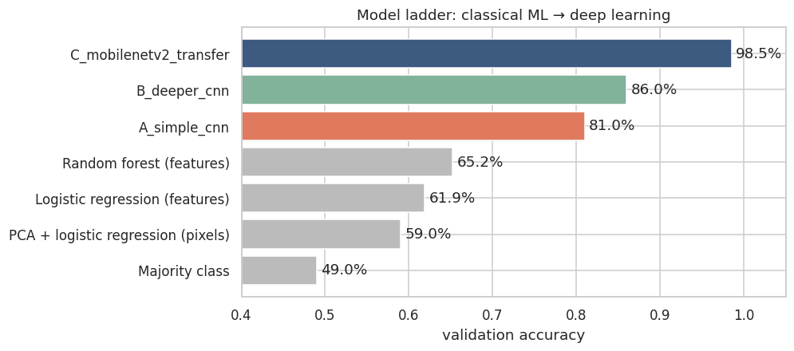
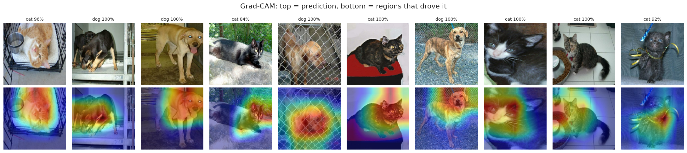

# Cats vs Dogs — an end-to-end deep-learning project

A complete machine-learning workflow on 23,262 pet photos: explore and clean the data, compare classical
models with neural networks, tune the best one, measure how far it can be trusted, and decide how it
should be used.

**Live report:** https://YOUR-PROJECT.vercel.app/ *(after connecting to Vercel or GitHub Pages, see below)*
**Notebook:** [`DeepLearning_CatsVsDogs_Complete.ipynb`](DeepLearning_CatsVsDogs_Complete.ipynb) — all cells executed, with written observations after every section
**Run it yourself:** [Open in Colab](https://colab.research.google.com/github/H-yz2022/cats-vs-dogs-deep-learning/blob/main/DeepLearning_CatsVsDogs_Complete.ipynb)

## Results

| | |
|---|---|
| **Test accuracy** | **98.37 %** (95 % bootstrap CI 97.81 – 98.84 %) on 2,324 unseen photos |
| Test ROC-AUC | 0.9991 |
| Test mistakes | 38 (20 cats called dogs, 18 dogs called cats) |
| Best classical-ML baseline | 65.2 % (random forest on image statistics) |
| Final model | MobileNetV2 (ImageNet) + tuned classification head |



## Pipeline

| Step | What happens | Key finding |
|---|---|---|
| 1. Data | TensorFlow Datasets `cats_vs_dogs` (Microsoft Asirra): 25,000 files, 1,738 corrupt | 23,262 usable photos |
| 2. Data quality | missing values, label/folder consistency, tiny/blank/blurry images, perceptual-hash duplicates | extra copies from 26 duplicate groups and 1 blank image removed (28 images in total) |
| 3. Univariate | class balance and distribution of size, brightness, contrast, colourfulness, sharpness | balanced classes; most photos are 500 × 375 px |
| 4. Bivariate | every statistic compared between cats and dogs (Mann–Whitney U, effect size) | all effects small (largest: sharpness, +0.26) |
| 5. Correlation | Pearson correlation and mutual information with the label | strongest link to the label only \|r\| = 0.19 |
| 6. Split & preprocessing | stratified group K-fold 80/10/10 (grouped by hash → no duplicate leakage), `tf.data`, augmentation | train 18,587 / val 2,323 / test 2,324 |
| 7. Baselines | majority class, logistic regression, random forest, PCA + logistic regression | best 65.2 % — hand-made features are weak |
| 8. Model selection | simple CNN vs deeper CNN (both from scratch) vs MobileNetV2 transfer learning | 81.0 % vs 86.0 % vs **98.5 %** |
| 9. Tuning | 36-trial grid (learning rate × dropout × hidden layer × batch size) on cached features | all trials 98.1 – 98.8 %; head barely sensitive |
| 10. Final training | tuned head (10 epochs), then fine-tuning the top of MobileNetV2 at lr 1e-5 | fine-tuning did not improve validation loss → stage-1 checkpoint kept |
| 11. Model quality | accuracy, precision/recall, ROC, calibration, error analysis, Grad-CAM | well calibrated; dark photos are the hardest; model looks at faces |
| 12. Decision policy | threshold choice, reject option ("ask a human"), out-of-distribution limits | threshold 0.5; abstaining on 2.6 % of photos raises accuracy to 99.5 % |
| 13. Improvements | brightness/contrast augmentation; ImageNet "is this a pet photo?" gate | augmentation not adopted; gate keeps 99.4 % of pets, rejects 85.9 % of flower photos and all noise |



## Repository layout

```
DeepLearning_CatsVsDogs_Complete.ipynb   the full project, executed (Colab, T4 GPU)
results/
  metrics.json                           every number in the report
  image_features.csv                     per-image statistics used in the EDA
  figures/                               all figures from the notebook
  cats_vs_dogs_mobilenetv2.keras         final model (v1)
  cats_vs_dogs_mobilenetv2_v2.keras      brightness-augmentation variant (not adopted)
docs/
  index.html                             self-contained report website (GitHub Pages)
  embed-snippet.html                     iframe code to embed the report in another site
requirements.txt
```

## Run it

**Google Colab (recommended):** open the notebook in Colab, choose *Runtime → Change runtime type → T4 GPU*,
then *Runtime → Run all* (about 45 minutes). The last cell downloads `results.zip`.

**Locally:**

```bash
pip install -r requirements.txt
jupyter notebook DeepLearning_CatsVsDogs_Complete.ipynb
```

Without a GPU the notebook shrinks its training budgets automatically (about 1.5 hours on a laptop CPU).
Finished training stages are saved in `results/cache/`, so an interrupted run resumes where it stopped.

**Use the trained model:**

```python
import numpy as np, tensorflow as tf
from tensorflow import keras
model = keras.models.load_model("results/cats_vs_dogs_mobilenetv2.keras")
img = tf.image.resize(tf.io.decode_image(open("my_pet.jpg", "rb").read(), channels=3), (160, 160))
p_dog = float(model(img[None], training=False)[0, 0])        # raw 0–255 pixels; scaling is inside the model
print("dog" if p_dog >= 0.5 else "cat", round(p_dog, 3))
```

## Publish the report

**Vercel:** *Add New → Project*, import this repository, set **Root Directory** to `docs`, Framework Preset
*Other*, no build command, then *Deploy*. Every push to `main` redeploys automatically.

**GitHub Pages (alternative):**

1. Push this repository to GitHub.
2. *Settings → Pages → Build and deployment → Source: Deploy from a branch*, branch `main`, folder `/docs`, *Save*.
3. After a minute the report is live at `https://H-yz2022.github.io/cats-vs-dogs-deep-learning/`.
   Put your live address in place of `YOUR-PROJECT.vercel.app` at the top of this README and in `docs/embed-snippet.html`.

## Data and credits

- Elson, Douceur, Howell & Saul, *Asirra: A CAPTCHA that Exploits Interest-Aligned Manual Image Categorization*, ACM CCS 2007. Photos from Petfinder.com via Microsoft Research.
- TensorFlow Datasets: [`cats_vs_dogs`](https://www.tensorflow.org/datasets/catalog/cats_vs_dogs) and [`tf_flowers`](https://www.tensorflow.org/datasets/catalog/tf_flowers) (used only to test the pet-photo gate).
- Sandler et al., *MobileNetV2: Inverted Residuals and Linear Bottlenecks*, CVPR 2018 (ImageNet weights via Keras Applications).
